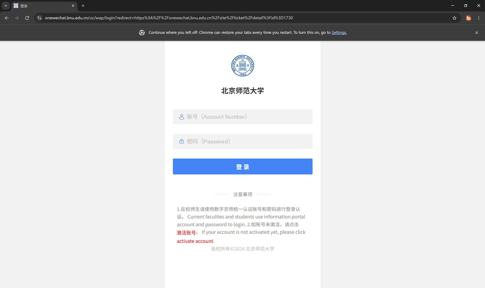
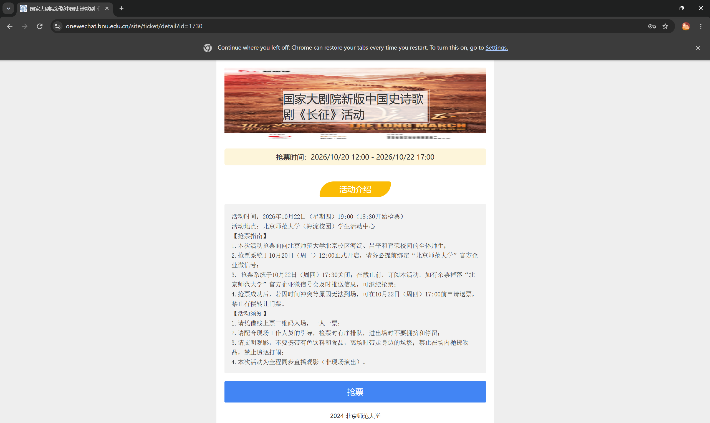

# 抢票脚本介绍
这个脚本针对北师大发票网站https://onewechat.bnu.edu.cn/site/ticket/detail?id=1730（这个数字是活动次数的标志，可以逐个递增更改），自己加入自己的学号和数字京师密码之后在python里运行就行了。
## 注意 需要检查头部相应库并安装
## 效果展示：
点击之后进入会自动进入网页（注意要求是谷歌浏览器）：

然后系统会自动进行登录和抢票，
抢票结束后或者弹出请勿重复点击自动刷新

最后的结果

